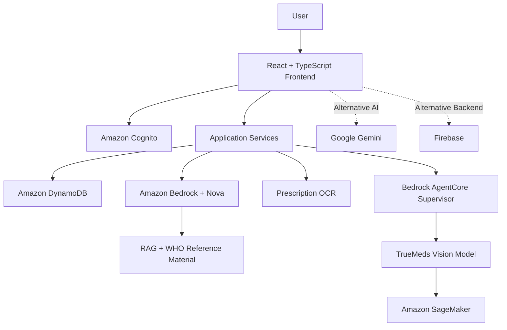

# 🌿 Aether Health

> **Harmonizing Global Health with the Elements of Nature**

Aether Health is an AI-powered healthcare platform designed to make health information more accessible, understandable, and less intimidating. Built around five elements—Fire, Water, Air, Earth, and Space—it brings together symptom support, water-safety reporting, prescription understanding, counterfeit-medicine screening, and inclusive health guidance.

The platform's primary architecture uses AWS services, including Amazon Bedrock, Nova models, Amazon SageMaker, AWS Amplify, Amazon Cognito, and Amazon DynamoDB. Google Gemini and Firebase are also supported as alternative integration options, depending on the deployment configuration.

**Developer:** [Debadrit Nag](https://github.com/DebadritNag)  
**Development period:** January 2026 – March 2026  
**Repository:** [Aether-Health-Ai](https://github.com/DebadritNag/Aether-Health-Ai)

   

---

## ✨ The Five-Element Framework

### 🔥 Fire — VitalScan
**Anxiety-aware symptom support**
- Provides conversational symptom assessments in a calm, empathetic tone.
- Uses context and sentiment-aware interaction to help reduce unnecessary health anxiety.
- Integrates Retrieval-Augmented Generation (RAG) grounded in relevant WHO guidelines and clinical reference material.
- Uses Amazon Bedrock with Nova models for the primary AWS-based AI workflow, with Gemini as an alternative integration where configured.

### 💧 Water — HydroGuard
**Community water-safety reporting**
- Visualizes water-safety information where data is available.
- Supports citizen reports of suspected contamination.
- Can associate location information with reports when permission is granted.
- Organizes reports for review and potential escalation to relevant authorities.

### 🌬️ Air — ClearScript
**Handwritten prescription understanding**
- Applies multimodal AI and OCR to images of handwritten prescriptions.
- Extracts readable text and helps identify potentially misspelled medicine names.
- Structures dosage and schedule information when legible.
- Supports medication-reminder workflows where configured.

Always confirm extracted medicine names and dosages with a pharmacist or prescribing clinician before use.

### 🌍 Earth — TrueMeds
**Computer-vision-assisted medicine screening**
- Analyzes medicine packaging and visual characteristics for potential inconsistencies.
- Uses reference data to support image-based screening.
- Uses a computer-vision model trained and deployed through Amazon SageMaker.
- Integrates with a Supervisor Agent using Amazon Bedrock AgentCore to coordinate the AI workflow.

Image screening cannot conclusively establish that a medicine is genuine. Suspected counterfeit products require independent verification.

### 🌌 Space — LifeLoop
**Connected and inclusive health guidance**
- Supports multilingual communication and translation where configured.
- Connects information from the platform's different modules.
- Offers general lifestyle and wellness guidance.
- Aims to make health information more accessible across language and cultural contexts.

---

## 🧠 Technology Stack

### AWS and AI
| Technology | Purpose |
|---|---|
| AWS Amplify | Frontend hosting and application delivery |
| Amazon Cognito | Authentication and identity management |
| Amazon DynamoDB | NoSQL application data storage |
| Amazon Bedrock | Foundation-model access and generative AI workflows |
| Amazon Nova | Language and multimodal AI tasks, depending on the configured model |
| RAG | Grounds relevant responses in a curated reference corpus, including WHO guidance |
| Amazon SageMaker | Training and deployment of the TrueMeds computer-vision model |
| Amazon Bedrock AgentCore | Supervisor-agent orchestration |

### Alternative integrations
- **Google Gemini:** Alternative conversational and multimodal AI provider.
- **Firebase:** Alternative authentication, database, and application-backend services where configured.

These are alternative or composable integration paths; the project does not require every provider to run simultaneously.

### Frontend
- React
- TypeScript
- Vite
- Tailwind CSS
- Framer Motion

### Development tools
- Git and GitHub
- npm
- Node.js

---

## 🏗️ Architecture Overview



*Conceptual architecture: actual connections depend on the deployed environment and application configuration.*

---

## 🛡️ Responsible AI and Safety

- **Evidence-aware responses:** Ground relevant health-information workflows in trusted reference material.
- **Explainability:** Communicate the sources and limitations behind AI-generated information wherever possible.
- **Decision support, not diagnosis:** Encourage professional medical care when appropriate.
- **Human verification:** Require independent confirmation of prescription details and suspicious medicines.
- **Privacy-conscious design:** Apply appropriate authentication, access controls, and secure data handling.
- **Transparent uncertainty:** AI responses, OCR, and computer-vision classifications can be wrong.

Aether Health is not a replacement for a qualified healthcare professional. No AI system can guarantee perfect medical accuracy or zero hallucinations.

---

## 🚀 Getting Started

### Prerequisites
- Node.js version compatible with the project's package configuration
- npm or the package manager specified by the project
- Git
- Credentials and resources for the selected AI and cloud providers

### 1. Clone the repository

```bash
git clone https://github.com/DebadritNag/Aether-Health-Ai.git
cd Aether-Health-Ai
```

### 2. Install dependencies

Navigate to the directory containing the applicable `package.json` file and run:

```bash
npm install
```

### 3. Configure your environment

Create the environment file expected by the application. Configure only the variables that your implementation actually reads.

For AWS, configure the appropriate region, IAM permissions, and required service resources. Prefer IAM roles and temporary credentials over hard-coded access keys.

For a Gemini-based deployment, configure the Gemini API key. For a Firebase-based deployment, configure the Firebase project and appropriate security rules.

Example configuration categories:

```env
AWS_REGION=your_aws_region
GEMINI_API_KEY=your_gemini_api_key
```

These are examples, not a guarantee that the application uses these exact variable names. Never commit credentials, API keys, service-account files, or patient data to Git.

### 4. Start the development server

From the directory containing the relevant scripts:

```bash
npm run dev
```

### 5. Build for production

```bash
npm run build
npm run preview
```

Use the scripts defined in the relevant `package.json`. AWS services such as Bedrock, SageMaker, Cognito, and DynamoDB require appropriate configuration and permissions beyond installing frontend dependencies.

---

## 📁 Project Structure

The repository contains the application in `Health-application-main/`. The following is a high-level representation of the frontend structure; verify the current repository for exact paths and additional services.

```text
Aether-Health-Ai/
├── Health-application-main/
│   ├── components/       # UI components
│   ├── services/         # AI and external-service integrations
│   ├── App.tsx           # Application entry component
│   ├── constants.tsx     # Application constants
│   ├── translations.ts   # Localization strings
│   ├── types.ts          # TypeScript definitions
│   └── vite.config.ts    # Vite configuration
└── README.md
```

---

## 🗺️ Project Summary

| Element | Module | Focus |
|---|---|---|
| 🔥 Fire | VitalScan | Symptom support and WHO-grounded RAG |
| 💧 Water | HydroGuard | Water-safety information and reporting |
| 🌬️ Air | ClearScript | Handwritten prescription OCR |
| 🌍 Earth | TrueMeds | SageMaker computer-vision screening |
| 🌌 Space | LifeLoop | Multilingual and connected health guidance |

## 🤝 Contributing

1. Fork the repository.
2. Create a branch: `git checkout -b feature/your-feature`.
3. Make and test your changes.
4. Commit your work: `git commit -m "Describe your change"`.
5. Push your branch and open a Pull Request.

Do not include secrets or identifiable patient information in commits, issues, or test fixtures.

## 📄 License

Check the repository's `LICENSE` file to confirm the applicable license and terms before reusing or redistributing this project.

## 🙏 Acknowledgments

- Amazon Web Services for cloud and AI infrastructure.
- Google Gemini for alternative multimodal AI integration.
- World Health Organization for relevant public health guidance and reference material.
- Open-source contributors and the healthcare community.

## 📬 Support

- [Report a bug or request a feature](https://github.com/DebadritNag/Aether-Health-Ai/issues)
- [Explore the repository](https://github.com/DebadritNag/Aether-Health-Ai)

---

<div align="center">

**Built by [Debadrit Nag](https://github.com/DebadritNag)**

*Making healthcare information clearer, calmer, and more accessible.*

</div>
